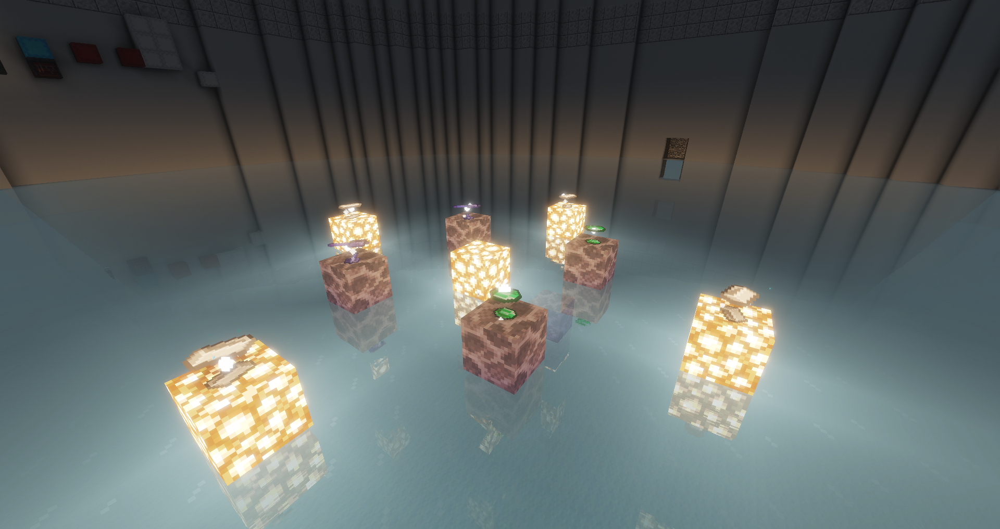
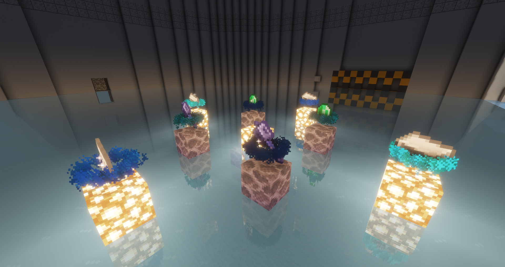
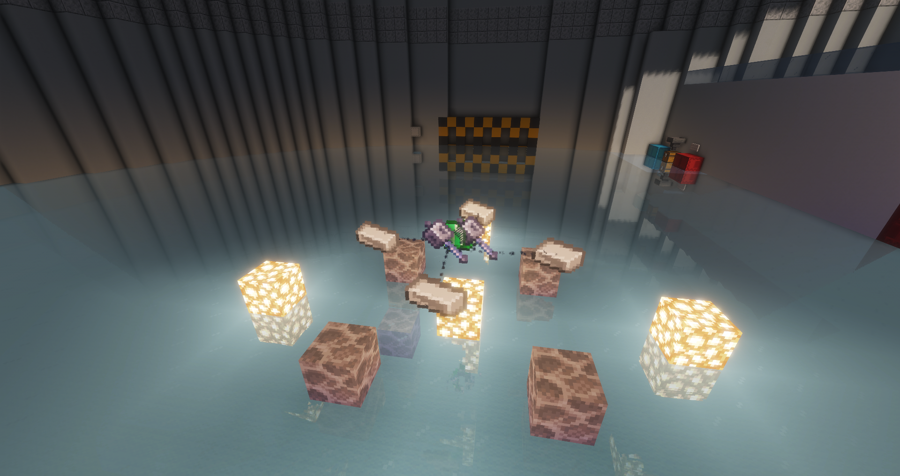
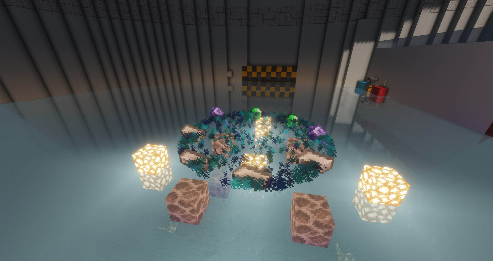
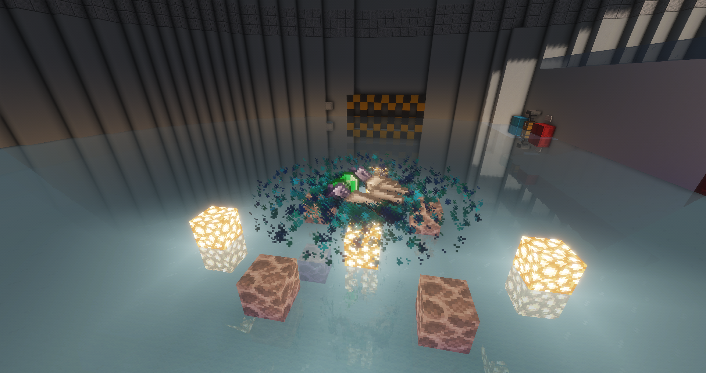
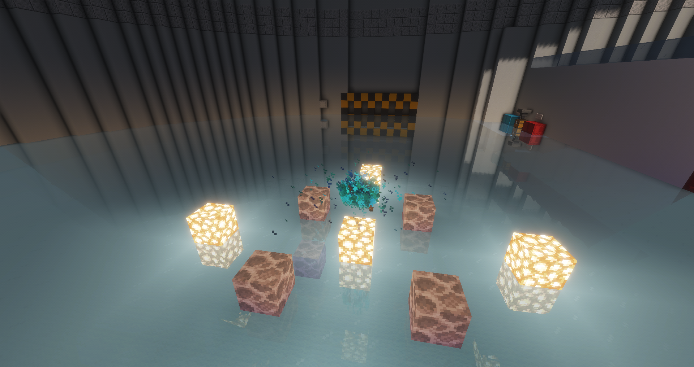
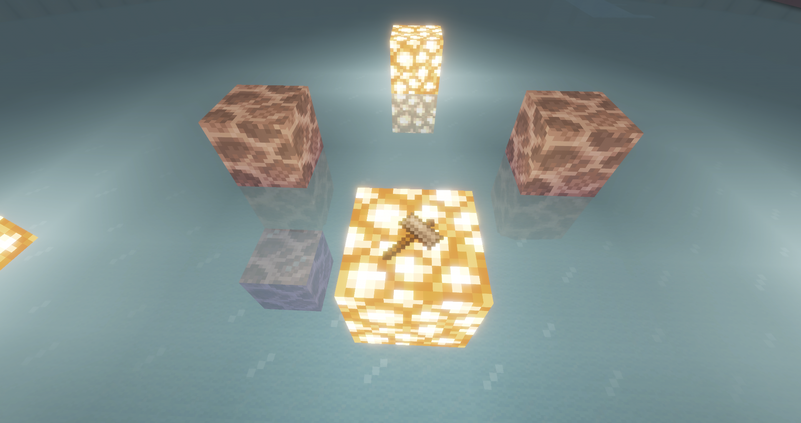

# AltarSfir

**AltarSfir** — плагин для Minecraft-серверов на Paper/Leaf 1.21.x с настраиваемыми алтарями и ритуальным крафтом. Здесь собрана демонстрация проекта.

> Исходный код и файл плагина не опубликованы. Этот репозиторий не предназначен для установки или самостоятельной сборки.

## Возможности

- Алтари с 4, 5, 6, 7, 8 или 10 пьедесталами.
- Создание алтарей и настройка рецептов прямо в игре.
- Рецепты с учётом расположения, количества и свойств предметов.
- Визуальные подсказки для подходящих ингредиентов.
- Ритуал с движением предметов, частицами и звуками.
- Сохранение алтарей и рецептов после перезапуска сервера.
- Отдельные права для игроков и администраторов.

## Демонстрация

### 1. Алтарь до запуска ритуала

Предметы на пьедесталах слегка парят над блоками, показывая подходящие ингредиенты.

### 2. Подъём ингредиентов

После запуска ритуала предметы поднимаются вверх в кольцах из частиц.

### 3. Ингредиенты собираются в центре

### 4. Эффект сбора

### 5. Ритуальные эффекты

### 6. Завершение ритуала

### 7. Готовый предмет

## Доступность и права

AltarSfir — частный проект. Публикация этой демонстрации не означает публикацию плагина или разрешение на его использование и распространение. Исходный код, сборка и данные сервера в этом репозитории отсутствуют.

© 2026 elfiysqiy. Все права на представленные авторские материалы защищены. Вопросы использования проекта и материалов согласуются с правообладателем отдельно.

Minecraft и связанные с ним материалы принадлежат их правообладателям. AltarSfir не является официальным продуктом Mojang или Microsoft.
